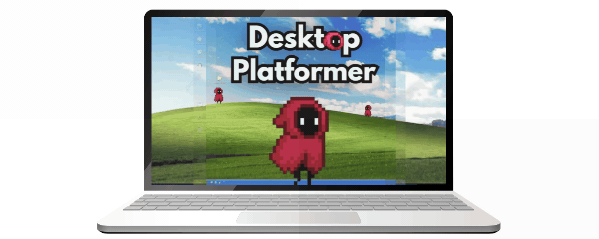
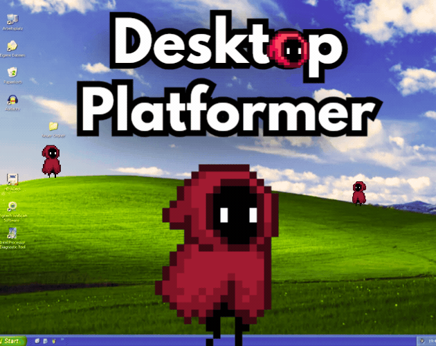

# Desktop Platformer

A little character that hangs out on your screen and treats your open windows and UI edges as platforms.

### What It Is

It's a transparent, click-through overlay game built on top of your desktop. You can use your computer normally, drag the character around, or control them across whatever is on your screen.

### How It Works

In the background, the app takes quick screenshots and uses OpenCV edge detection to find solid edges on your screen (making sure to ignore the character itself). It turns those edges into collision floors so your character can run, jump, and land on things as you move windows around.

## Controls

- Move: Arrow keys or A / D

- Jump: Up or W

- Fast-fall: Down or S

- Drag: Left-click and drag the character

- Menu / Settings: Right-click the character to tweak speed, gravity, size, FPS, and more (saved automatically)

## Watch the Demo on YouTube
[](https://youtu.be/9kWXviMXn8c)

## Setup & Run

```
pip install -r requirements.txt
python main.py
```

## Platforms

Should work properly on Windows11 and MacOS
- On macOS, you'll need to allow Screen Recording and Accessibility permissions the first time so screen capture and mouse tracking work

I have not tested it on Linux
- but theoretically it should work on X11
- probably will not work on Wayland, as it denies screenshot permissions
